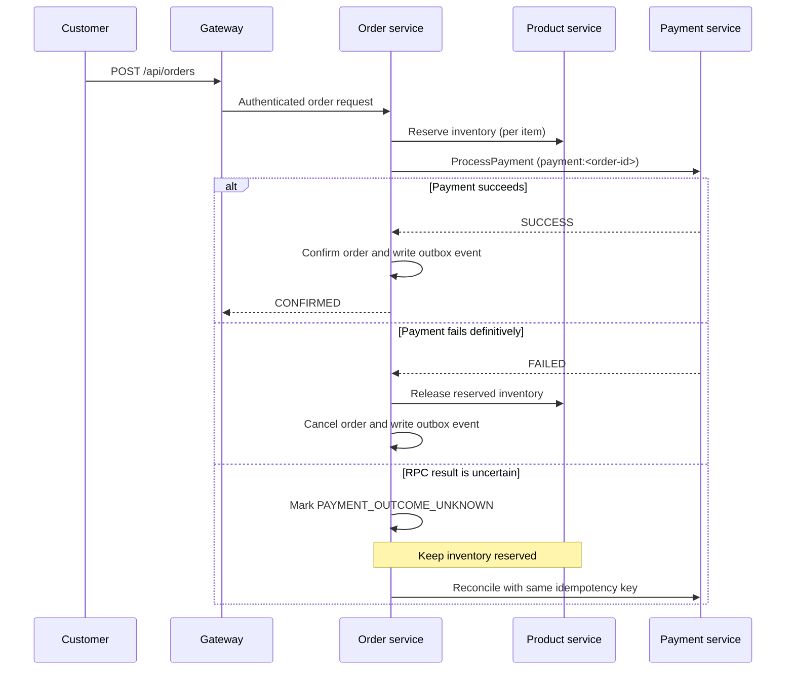

# OrderFlow

OrderFlow is a microservices-based e-commerce application that demonstrates how an online shopping platform can manage users, products, carts, orders, and payments through independent backend services.

Instead of handling everything inside one large application, OrderFlow separates business responsibilities into individual services that communicate through REST, gRPC, and asynchronous events. This makes the repository a practical example of coordinating a multi-step order workflow, handling service failures, and processing background tasks without coupling every operation to one application process.

OrderFlow is an engineering demonstration, not a production e-commerce business serving customers. Payments use a local mock provider, and the notification worker logs a mock message; the repository does not currently process real charges or send live notifications.

## What real-world problem does it demonstrate?

When a customer places an order, an e-commerce backend must coordinate the order, inventory, and payment. Those operations live in separate systems and can fail or respond slowly. OrderFlow models the engineering challenges involved:

- **Order and payment coordination:** an order follows explicit states while payment is processing, succeeds, fails, or has an uncertain outcome.
- **Service independence:** authentication, products, orders, payments, and notifications have separate responsibilities and data stores.
- **Slow background work:** order events move through a queue so notification work does not block the customer request.
- **Repeated requests:** per-order payment idempotency and client order idempotency help prevent duplicate side effects when requests are retried.
- **Performance:** Redis supports cart storage, product caching, and the event pipeline.
- **Operational reliability:** Docker Compose, health checks, automated service checks, and an end-to-end browser journey help developers run and verify the system.

These are architectural demonstrations based on the current codebase; they should not be read as claims that OrderFlow is a complete production commerce platform.

## Main features

- Customer registration and login, product browsing and search, product details, cart management, order placement, order history, order details, and eligible order cancellation.
- Independent user, product, order, payment, and notification services behind an API Gateway.
- A saga-style order lifecycle with inventory reservation and compensating release.
- A transactional outbox, Redis Streams, and BullMQ background notification pipeline with retry handling.
- JWT authentication, role checks, input validation, rate limits, and request correlation IDs.
- Docker Compose setup, health endpoints, GitHub Actions service checks, and an end-to-end browser journey.

## Customer journey

1. Create an account or sign in.
2. Browse the catalog, search products, and add items to the cart.
3. Place an order. The backend coordinates inventory and mock payment processing across services.
4. View the order status and details from order history while the backend processes events asynchronously.

The storefront is designed to make that journey straightforward while the backend handles service-to-service coordination.

For step-by-step environment setup and troubleshooting, see [SETUP.md](SETUP.md).

## Architecture

```text
Browser -> Next.js frontend -> API Gateway -> User, Product, Order, Payment services
                                                   |
                                          PostgreSQL / MongoDB
                                                   |
                                   Order outbox -> Redis Stream
                                                   |
                                          BullMQ notification queue
                                                   |
                                      Notification worker (mock output)
```

Order status events are committed to the order service's database outbox. The outbox publisher sends them to the `order-events` Redis Stream. The notification service enqueues them into BullMQ's `order-notifications` queue and acknowledges the stream event after the queue accepts it. BullMQ retries failed jobs with exponential backoff. The current notification handler logs a mock email; it does not send email or push browser notifications.

### Order and payment flow

The gateway authenticates the customer and requires an `Idempotency-Key` header on order creation. The order service scopes the key to the authenticated user, stores a fingerprint of the item list, and returns the existing order for a retry with the same key and payload. Reusing a key with different items returns `409 Conflict`. The service validates the active user and product details, persists a `PENDING` order, reserves each product through an atomic MongoDB update, and calls the payment service over gRPC with the stable payment idempotency key `payment:<order-id>`. A successful mock payment confirms the order. A definite payment failure releases reservations and cancels the order.

If the payment RPC fails after processing starts, its outcome may be uncertain: the payment service could have committed the result while the response was lost. In that case the order moves to `PAYMENT_OUTCOME_UNKNOWN`, returns HTTP 503, and keeps inventory reserved. A background reconciliation loop retries the idempotent payment request. It confirms the order on `SUCCESS`; it releases inventory and cancels only after a definitive `FAILED` result. This tolerates duplicate payment requests, but the payment provider is still a local mock and there is no real-provider webhook or reconciliation API.



The outbox publisher is at-least-once: a crash after Redis accepts an event but before `published_at` commits can publish it again. Stream-to-BullMQ handoff uses the event key as the BullMQ job ID and acknowledges the stream only after queue insertion. Consumers must tolerate duplicates; this is not exactly-once delivery. Notification processing is currently a mock log handler, with no persistent in-app notifications, email provider, or Socket.IO channel.

## Services

| Service | Runtime | Responsibility |
| --- | --- | --- |
| `frontend` | Next.js, React | Customer storefront |
| `gateway` | Node.js, TypeScript, Express | Public REST API, JWT validation, authorization, rate limits |
| `user-service` | Python, FastAPI, PostgreSQL | Registration, authentication, user data |
| `product-service` | Node.js, TypeScript, MongoDB, Redis | Catalog and inventory |
| `order-service` | Python, FastAPI, PostgreSQL, Redis | Cart, order saga, durable event outbox |
| `payment-service` | Node.js, TypeScript, PostgreSQL | Idempotent mock payments |
| `notification-service` | Node.js, BullMQ, Redis | Stream bridge and asynchronous notification worker |

## Start the application

Requirements: Docker Desktop running with Linux containers and Docker Compose v2.

1. Create the local environment file:

   ```powershell
   Copy-Item .env.example .env
   ```

2. Set `JWT_SECRET` in `.env` to a random value of at least 32 characters. The example credentials are for local development only.
3. From the repository root, build and start all services:

   ```powershell
   docker compose up --build
   ```

   To run in the background, add `-d`:

   ```powershell
   docker compose up --build -d
   ```

Open the storefront at <http://localhost:30001> and the API gateway at <http://localhost:30000>. Check container health with `docker compose ps`, view logs with `docker compose logs -f`, and stop the stack with `docker compose down`.

Local database ports are bound to loopback: PostgreSQL `15432`, MongoDB `27018`, and Redis `16379`. The services communicate over the Compose network. Compose reads `.env` for variable substitution and passes only each service's explicitly declared environment variables into its container.

## Configuration and security

Start from `.env.example`. Keep `.env` out of source control; it is ignored by Git. Do not use the example passwords or JWT secret outside local development. The production Compose overlay requires `GHCR_OWNER`, `POSTGRES_PASSWORD`, `JWT_SECRET`, `USER_DATABASE_URL`, `ORDER_DATABASE_URL`, `PAYMENT_DATABASE_URL`, `MONGODB_URI`, and `REDIS_URL`. Use protected deployment secrets and a TLS-enabled `rediss://` Redis URL in production.

The notification service uses a stable `CONSUMER_NAME` so it can resume that consumer's pending Redis Stream entries after a restart. Use a distinct stable name for each replica. `NOTIFICATION_CONCURRENCY` controls each worker's concurrent job count. `NOTIFICATION_QUEUE_NAME`, `STREAM_NAME`, and `CONSUMER_GROUP` can also be configured in `.env`.

## API

Public routes are served under `/api`:

| Method | Path | Access | Purpose |
| --- | --- | --- | --- |
| `POST` | `/auth/register` | Public | Register a customer |
| `POST` | `/auth/login` | Public | Authenticate |
| `GET` | `/products` | Public | List products |
| `GET` | `/products/:id` | Public | Get a product |
| `GET` | `/products/search?q=` | Public | Search products |
| `POST` | `/products` | Admin | Create a product |
| `PATCH` | `/products/:id` | Admin | Update product details or stock |
| `DELETE` | `/products/:id` | Admin | Delete a product |
| `POST` | `/cart` | Customer | Replace the cart |
| `GET` | `/cart` | Customer | Read the cart |
| `POST` | `/cart/items` | Customer | Add cart items |
| `DELETE` | `/cart/items/:productId` | Customer | Remove a cart item |
| `POST` | `/orders` | Customer | Place an order |
| `GET` | `/orders` | Customer or Admin | List orders |
| `GET` | `/orders/:id` | Customer or Admin | Read an order |
| `POST` | `/orders/:id/cancel` | Customer or Admin | Cancel an eligible order |
| `GET` | `/health` | Public | Check gateway health |

`POST /api/orders` requires `Idempotency-Key` (1–128 letters, digits, `.`, `_`, `:`, or `-`). Keep the same key when retrying the same order request.

Internal services expose `/health`; FastAPI services also expose `/docs`. Service contracts are in [`proto/`](proto/).

## Development checks

Run Python tests from each service directory:

```powershell
cd services/user-service; pytest tests
cd ../order-service; pytest tests
```

Run Node tests and TypeScript builds:

```powershell
cd gateway; npm ci; npm test; npm run build
cd ../services/product-service; npm ci; npm test; npm run build
cd ../payment-service; npm ci; npm test; npm run build
cd ../notification-service; npm ci; npm run check
```

The browser journey is in [`tests/e2e/`](tests/e2e/). CI runs service checks and builds the full Docker Compose stack before running the end-to-end journey.

## Production deployment

See [`infrastructure/aws/README.md`](infrastructure/aws/README.md). The production overlay uses published GHCR images and requires explicit configuration for deployment credentials and data services. Keep secrets in a protected environment and restrict database and Redis access to the application network.
